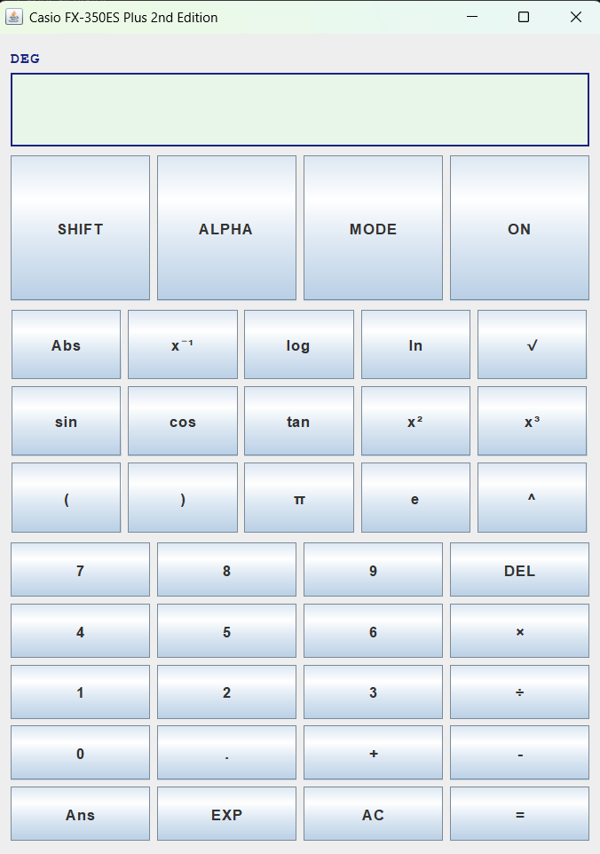

# Java Scientific Calculator  Casio FX-350ES Plus 2nd Edition


A desktop scientific calculator written in pure Java that replicates the layout and behavior of the Casio FX-350ES Plus 2nd Edition. The Swing GUI is cleanly separated from a standalone expression parser, so the math engine can be tested and reused independently of the interface.

<p align="center">
  
</p>

<p align="center"><em>Current UI: the calculator running on Windows, in DEG mode.</em></p>

---

## Table of Contents

- [Features](#features)
- [Tech Stack](#tech-stack)
- [Architecture](#architecture)
- [Requirements](#requirements)
- [Quick Start](#quick-start)
- [Git Workflow](#git-workflow)
- [Usage](#usage)
- [Supported Functions](#supported-functions)
- [Design Decisions](#design-decisions)
- [Testing](#testing)
- [Roadmap](#roadmap)
- [Contributing](#contributing)
- [License](#license)
- [Author](#author)

---

## Features

- Casio-style keypad with **SHIFT**, **ALPHA**, **MODE**, and **ON** modifier keys
- Scientific functions: `sin`, `cos`, `tan`, their inverses, `log`, `ln`, `sqrt`, `^`, `abs`
- Constants: `π` (pi) and `e` (Euler's number)
- **DEG / RAD** angle mode toggle
- `Ans` memory to reuse the previous result
- `EXP` button for scientific notation (`×10^`)
- Full keyboard support: type directly, `Enter` to evaluate, `Esc` to clear
- Resizable window with a sensible minimum size
- Zero external dependencies — pure Java SE

---

## Tech Stack

| Layer | Technology |
|---|---|
| Language | Java (JDK 11+, tested on JDK 17) |
| Frontend | Java Swing (`JFrame`, `GridLayout`, `BoxLayout`) |
| Backend | Custom recursive-descent parser |
| Build | `javac` — no build tool required |
| Version Control | Git / GitHub |

---

## Architecture

The project uses a strict two-layer split:

```
+---------------------------+         +--------------------------------+
|     FRONTEND (Swing)      |  calls  |      BACKEND (pure Java)       |
|    CasioCalculatorApp     | ------> |  ScientificCalculatorService   |
|  - buttons, display       | <------ |  - parses & evaluates          |
|  - SHIFT / ALPHA state    |  result |  - DEG/RAD, Ans, variables     |
+---------------------------+         +--------------------------------+
```

Project layout:

```
Java_mini_project/
|-- src/
|   |-- ScientificCalculatorService.java   # Backend: parser + evaluator
|   `-- CasioCalculatorApp.java            # Frontend: Swing GUI
|-- docs/
|   `-- screenshot.png                     # UI screenshot used in this README
|-- .gitignore
|-- README.md
`-- out/                                   # Compiled .class files (gitignored)
```

The GUI never performs any math. It forwards the expression string to `ScientificCalculatorService.evaluate(...)` and renders the returned result. This means the backend can be swapped for a JavaFX or web frontend without touching the parser, and the parser can be unit-tested without a display.

---

## Requirements

- **JDK 11 or higher** installed and on `PATH`

Verify with:

```powershell
java -version
javac -version
```

---

## Quick Start

Clone the repository:

```powershell
git clone https://github.com/Lowellowuor/Java_mini_project.git
cd Java_mini_project
```

Compile and run from the project root:

```powershell
javac -encoding UTF-8 -d out src\ScientificCalculatorService.java src\CasioCalculatorApp.java
java -cp out CasioCalculatorApp
```

That's it — no Maven, no Gradle, no external libraries.

---

## Git Workflow

Everyday commands for editing this project and keeping GitHub in sync.

### Get the latest changes

```powershell
git pull origin main
```

### Make and save changes

```powershell
git status                          # see what you changed
git add .                           # stage everything
git commit -m "feat: describe your change"
git push origin main                # upload to GitHub
```

### Work on a feature branch

```powershell
git checkout -b feature/memory-keys   # create and switch to a new branch
git add .
git commit -m "feat: add memory registers"
git push -u origin feature/memory-keys
```

Then open a Pull Request on GitHub to merge the branch into `main`.

### Update the README or screenshot only

```powershell
git add README.md docs/screenshot.png
git commit -m "docs: update README and screenshot"
git push origin main
```

### Useful extras

| Command | Purpose |
|---|---|
| `git log --oneline` | Compact commit history |
| `git diff` | Show unstaged changes |
| `git restore <file>` | Discard local changes to a file |
| `git checkout main` | Switch back to the main branch |
| `git branch -d <name>` | Delete a merged branch |

### Commit message convention

```
feat:     new feature
fix:      bug fix
docs:     documentation only
refactor: code restructure, no behavior change
test:     add or update tests
chore:    build or tooling
```

---

## Usage

### Basic operations

- Click buttons or type expressions directly into the display
- Operators: `+`, `-`, `×`, `÷`, parentheses `( )`, decimal `.`
- Press `=` or `Enter` to evaluate
- Press `AC` or `Esc` to clear
- Press `DEL` to delete the last character

### Modifier keys

| Key | Behavior |
|---|---|
| `SHIFT` | Activates the secondary function of the next key, e.g. `SHIFT` + `sin` gives `asin(` |
| `ALPHA` | Activates the variable label of the next key, e.g. `ALPHA` + `sin` gives `A` |
| `MODE` | Toggles between DEG and RAD angle modes |
| `ON` | Clears the display and resets all modifiers |

### Examples

| Expression | Result | Notes |
|---|---|---|
| `2+3×4` | `14` | Operator precedence respected |
| `(2+3)×4` | `20` | Parentheses |
| `sin(30)` | `0.5` | DEG mode |
| `log(100)` | `2` | Base-10 logarithm |
| `sqrt(16)` | `4` | Square root |
| `2^10` | `1024` | Power operator |
| `π` | `3.14159…` | Pi constant |
| `Ans+5` | previous + 5 | Reuses last answer |

---

## Supported Functions

| Function | Primary Button | SHIFT Function |
|---|---|---|
| Sine | `sin(` | `asin(` |
| Cosine | `cos(` | `acos(` |
| Tangent | `tan(` | `atan(` |
| Base-10 log | `log(` | `10^(` |
| Natural log | `ln(` | `e^(` |
| Square root | `sqrt(` | `^2` |
| Square | `^2` | `^3` |
| Cube | `^3` | — |
| Reciprocal | `^(-1)` | — |
| Absolute value | `abs(` | — |
| Power | `^` | — |
| Pi | `π` | `e` |

---

## Design Decisions

**Custom recursive-descent parser instead of `ScriptEngine` / `eval`.**
Java's built-in JavaScript engine (Nashorn) was removed in JDK 15, and evaluating user input through a scripting engine is never safe for untrusted input. A hand-written parser gives precise control over operator precedence, unary operators, and scientific functions, and it keeps the project free of external dependencies.

**Backend / frontend split.**
The parser has no reference to `javax.swing.*` and the GUI has no `Math.*` calls. This makes the engine unit-testable and the GUI replaceable.

**Manual layout over a GUI builder.**
`GridLayout` + `BoxLayout` keeps the layout code readable, version-controllable, and free of IDE-generated `.form` files.

**No Maven / Gradle.**
For a single-module project with zero dependencies, `javac` is simpler and lets anyone clone-and-run in two commands.

---

## Testing

The backend is designed to be tested independently of the GUI. To add tests:

1. Create `src/ScientificCalculatorServiceTest.java`.
2. Cover edge cases like `2+3*4` (precedence), `(2+3)*4` (parentheses), `-3*-2` (unary), `1/0` (division by zero), and `sin(30)` in both DEG and RAD.
3. Compile and run with JUnit 5 when you introduce a build tool.

### Manual smoke test

| Input | Expected |
|---|---|
| `2+3×4` then `=` | `14` |
| `1÷0` then `=` | `Math ERROR` |
| `sin(30)` (DEG) then `=` | `0.5` |
| `2^10` then `=` | `1024` |

---

## Roadmap

- [ ] JUnit 5 test suite for `ScientificCalculatorService`
- [ ] History panel showing the last N evaluations
- [ ] Memory registers (`M+`, `M-`, `MR`, `MC`)
- [ ] Fraction and complex-number results
- [ ] Dark mode theme
- [ ] Optional packaging as a runnable `.jar`:

  ```powershell
  jar --create --file calculator.jar --main-class CasioCalculatorApp -C out .
  ```

---

## Contributing

1. Fork [Lowellowuor/Java_mini_project](https://github.com/Lowellowuor/Java_mini_project) on GitHub.
2. Create a feature branch: `git checkout -b feature/your-feature`
3. Commit your changes: `git commit -m "Add your feature"`
4. Push: `git push origin feature/your-feature`
5. Open a Pull Request describing the change and why it's needed.

Please keep the backend parser free of GUI imports and keep the frontend free of math logic. The separation is what makes this project easy to extend.

---

## License

This project is released under the MIT License. See [LICENSE](./LICENSE) for details.

---

## Author

**Lowell Owuor**
GitHub: [@Lowellowuor](https://github.com/Lowellowuor)
Repository: [Java_mini_project](https://github.com/Lowellowuor/Java_mini_project)
